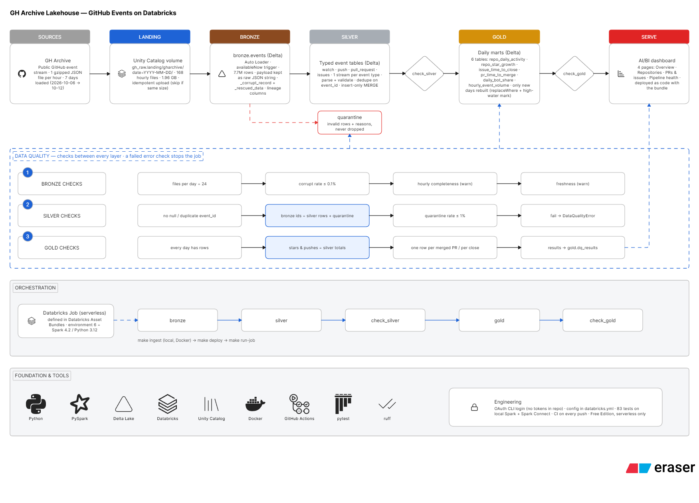

# GH Archive Lakehouse on Databricks

An incremental PySpark + Delta Lake pipeline that turns GitHub's public event stream
([GH Archive](https://www.gharchive.org/)) into tested, reconciled analytics tables and a
dashboard, on Databricks Free Edition serverless compute.



**One week loaded (2026-10-06 → 2026-10-12):**

| Layer | Result |
|---|---|
| Landing | 168 hourly files, 1.96 GB gzipped |
| Bronze | 7,727,123 raw events, 0 corrupt lines |
| Silver | 6,256,971 typed events in 4 tables, reconciled exactly with bronze, 0 in quarantine |
| Gold | 6 daily tables, reconciled with silver |
| Quality | 0 failing checks; warnings for gaps in GitHub's own data (see below) |

Everything is defined as code: the job and the dashboard deploy with Databricks Asset
Bundles, and all development runs in Docker. Unit tests run against local Spark **and**
a local Spark Connect server, the client API Databricks serverless uses.

## How it works

| Step | Where | What it does |
|---|---|---|
| Ingestion | your machine, in Docker | Downloads hourly files and uploads them to a Unity Catalog volume under `gharchive/date=YYYY-MM-DD/`. Free Edition restricts outbound internet, so this can't run in the workspace. |
| `bronze` | serverless job task | Auto Loader appends new files to one Delta table. The envelope is typed; `payload` stays a raw JSON string. |
| `silver` | serverless job task | Per event type: parse the payload with an explicit schema, validate, dedupe on `event_id`, insert-only `MERGE`. Failures go to `quarantine` with reasons. |
| `check_silver` | serverless job task | File counts, corrupt rate, hourly completeness, freshness, key checks, and reconciliation: bronze ids = silver rows + quarantined ids. |
| `gold` | serverless job task | Rebuilds the six daily tables for the days silver got new data for, and nothing else. |
| `check_gold` | serverless job task | Every day present, and gold totals equal silver totals. |
| Dashboard | AI/BI (Lakeview) | Four pages: overview, repositories, PRs & issues, pipeline health. |

A failed `error` check fails its task, and the tasks after it don't run. All check
results, passing or not, are appended to `gold.dq_results`.

## What the data taught this pipeline

The schemas weren't written from memory: Phase 0 profiled a real hourly file, and the
running pipeline surfaced more. Each finding changed the code or the dashboard.

1. **GitHub slimmed its event payloads.** Compared with October 2024, `PushEvent` lost its
   commits and sizes, and `PullRequestEvent.pull_request` went from 48 fields to 5 (no
   `created_at`, `merged_at` or author). PR merges are now their own `merged` action.
   Commit counts and PR sizes can't be built from this data.
2. **The feed is a sample.** Over the whole week a PR appears in 1.02 events on average,
   and of 14,571 closes of issues *created* during the week only 289 (2%) have their
   `opened` event in the data. Roughly 2% of related events survive, at random. So PR
   time-to-merge, which has to pair an `opened` with a `merged` event, can time only 1.8%
   of the 95,337 merges, and more days don't help. The dashboard reports merges and that
   coverage instead of a misleading duration. Issue time-to-close is reliable because the
   issue payload carries its own timestamps (median 0.7 days over 23,160 closes). Totals
   undercount GitHub; shares and day-to-day comparisons hold up.
3. **Gaps in the source.** There are *no* PushEvents at all on 2026-10-07, and none in
   some hours of 10-06 (20–23 UTC), 10-08 (0–2), 10-09 (16–23) and 10-10 (0). All files
   are present and valid, so file counts and reconciliation can't see this. A
   warning-level `hourly_completeness` check records every gap, and the dashboard plots
   pushes per hour with gaps as zero.
4. **Stale issue snapshots.** 147 of 23,160 `closed` IssuesEvents carry an issue object
   that still says `state: open` with no `closed_at`, a snapshot taken just before the
   close. A first validation rule quarantined them; the reconciliation check exposed it.
   They are genuine events, so silver keeps them and gold uses the event's own timestamp
   as the close time (`closed_at_from_event`).
5. **SHA-256 repositories.** One push had a 64-character `head` hash. GitHub supports
   SHA-256 repositories, and the original 40-character rule quarantined it. Quarantine did
   its job: the rule was widened and the event replayed into silver.
6. **Bots are a fifth of the activity.** 21.3% of modelled events come from logins ending
   in `[bot]` (27.9% of pull request events). The most "active" repositories are
   single-account push streams such as automated mirrors.

## Design decisions and trade-offs

**Bronze keeps `payload` as a string.** When Spark's JSON reader meets an object where the
schema says string, it keeps the object's JSON text. Bronze never breaks when GitHub
reshapes a payload; silver parses each type with its own explicit schema. The alternative,
letting Auto Loader infer and evolve one merged struct for 15 event types, would churn on
every upstream change. Unknown top-level fields go to `_rescued_data`, malformed lines to
`_corrupt_record`: bronze drops nothing.

**Incremental everywhere, never reprocess.** Ingestion skips hours already in the volume
(same size as on GH Archive). Bronze and silver are `availableNow` streams: checkpoints
remember what was processed, and serverless only allows this kind of trigger anyway.
Gold keeps a high-water mark on silver's `_processed_at` and replaces only the affected
days with Delta `replaceWhere`. Two tables widen that range on purpose: running star
totals change every later day, and a PR's merge row is redone when its `opened` event
arrives later.

**Idempotent by construction.** Events never change, so silver's `MERGE` only inserts
unseen `event_id`s: a rerun, a duplicate delivery (the data has them) or a replay after
`make reset-checkpoint` can't create duplicates. Quarantine appends use Delta's
`txnAppId`/`txnVersion`, so a retried micro-batch is skipped.

**One stream per event type** instead of one dispatcher. Four reads of bronze cost little
at this size, while failures stay isolated and a new event type automatically processes
all of history. A fifth `unclassified` stream catches corrupt rows whose type couldn't be
read, so every bad line reaches quarantine exactly once.

**Strict validation, from data.** Allowed `action` values were taken from a full day of
data; anything new is quarantined as `unexpected_action:<value>`, so upstream changes get
noticed rather than silently skewing gold. Casts use `try_cast` because Spark 4 runs in
ANSI mode, where a bad value would otherwise fail the whole batch.

**Quality checks reconcile, not just count.** The key silver check is
`distinct bronze ids = silver rows + quarantined ids`, per type and per day, matched on the
*file* date so rows with an unparseable timestamp still count. Results are stored in
`dq_results`. Freshness and completeness are warnings: this project backfills past days,
and failing the job can't fix a gap in GitHub's feed.

**`is_bot` = login ends in `[bot]`.** That's the GitHub App suffix: precise, but a lower
bound (accounts like `LizardByte-bot` aren't counted). For issue authors the payload's
`user.type == "Bot"` is used instead.

**Configuration in one place.** Catalog, schema and volume names are variable defaults in
[`databricks.yml`](databricks.yml). The Python code reads the same file locally; the job
passes the resolved values as task parameters; the dashboard gets them through
`dataset_catalog`/`dataset_schema`. Names are restricted to plain identifiers because
they're interpolated into SQL.

**Spark and Delta are dev-only dependencies.** Serverless ships its own Spark; a second
`pyspark` in the deployed wheel would shadow it. Locally they're pinned to what serverless
reports (Spark 4.2.0, Python 3.12, serverless environment 6).

**Tests run through Spark Connect too.** Serverless runs PySpark as a Spark Connect
client, which rejects things classic PySpark accepts. Four bugs passed local tests and
failed on Databricks (`withColumns({})`, `mode("errorifexists")`, `numInputRows: None`,
`SystemExit` in a task). `make test-connect` runs the suite against a local Spark Connect
server and catches this class of bug; CI runs both modes.

## Running it

You need Docker (on Windows with WSL integration enabled), `make` and `git`. Nothing else
is installed on your machine: Python, Java, Spark and the Databricks CLI live in the image.
A Databricks Free Edition workspace is enough.

```bash
make build                                          # dev image; also creates .env
make auth-login HOST=https://<workspace>.cloud.databricks.com   # OAuth, once
make whoami                                         # check the login

make setup-uc                                       # schemas + volumes (safe to rerun)
make ingest START=2026-10-06 END=2026-10-12         # 168 files, ~2 GB; one day is ~340 MB
make deploy                                         # wheel + job + dashboard
make run-job                                        # bronze → silver → checks → gold → checks
```

Load more days the same way: `make ingest START=… END=…`, then `make run-job`. Only the
new days are processed; the `gold` task prints which dates it rebuilt. Other targets
(`make help` lists them all):

| Command | Purpose |
|---|---|
| `make check` | Lint, then the tests on classic Spark and through Spark Connect (what CI runs) |
| `make recheck DATES=2026-10-06` | Re-run the bronze/silver checks for past days |
| `make reset-checkpoint NAME=silver_issues_events` | Replay one stream from the start (safe: `MERGE` skips known ids) |
| `make ingest START=… ARGS=--dry-run` | Show what ingestion would download |
| `make shell` | A shell inside the dev container |

**Fixing quarantined events.** When a validation rule turns out to be wrong (as with the
SHA-256 hashes), fix the rule, then replay that event type and remove the stale entries:

```bash
make deploy
make reset-checkpoint NAME=silver_push_events     # the stream re-reads bronze; MERGE adds only missing ids
```
```sql
DELETE FROM workspace.gh_silver.quarantine        -- before the next run, see below
WHERE target_table = 'workspace.gh_silver.push_events' AND array_contains(reasons, 'invalid_head_sha');
```
```bash
make run-job                                      # gold rebuilds only the days that gained rows
```

Delete the quarantine entries *before* `make run-job`: an event that is both in silver
and still in quarantine is counted twice, and the reconciliation check fails the job.

**Login details.** `make auth-login` runs the CLI's OAuth flow inside the container; the
browser redirect to `localhost:8020` is forwarded in (see
[`scripts/auth-login.sh`](scripts/auth-login.sh)). The CLI config and tokens live in the
Docker volume `gh-archive-lakehouse_databricks-auth`, never in the repo or your home folder;
`docker volume rm gh-archive-lakehouse_databricks-auth` logs out. The profile name comes from
`DATABRICKS_CONFIG_PROFILE` in `.env` (default `gh-lakehouse`).

**Configuration.** Defaults are in [`databricks.yml`](databricks.yml); override any locally
with `GHL_<NAME>` in `.env`, e.g. `GHL_CATALOG=main`.

| Setting | Default |
|---|---|
| catalog | `workspace` |
| raw_schema (landing + checkpoint volumes) | `gh_raw` |
| bronze_schema | `gh_bronze` |
| silver_schema (incl. quarantine) | `gh_silver` |
| gold_schema (incl. `dq_results`, `pipeline_state`) | `gh_gold` |
| landing_volume / checkpoint_volume | `landing` / `checkpoints` |

## Tests

83 pytest tests run on a local Spark session with Delta Lake, in the dev container. The
fixture [`tests/fixtures/gharchive_sample.jsonl`](tests/fixtures/gharchive_sample.jsonl)
is 21 real events from 2026-10-06, chosen to include every modelled type, a duplicate
event and a PR opened and merged in the same hour. Edge cases are built by editing real
events (bad ids, unknown actions, stale snapshots, truncated JSON). Highlights:

- every validation reason maps to its exact quarantine entry, and every corrupt line is
  quarantined exactly once
- streams pick up only new data; a retried micro-batch writes nothing twice
- gold rebuilds only new days, old days' rows stay unchanged, and a merge is re-timed when
  its `opened` event arrives later (out-of-order backfill)
- each quality check has a passing case and a deliberately broken one

## Limitations, and what I'd change at production scale

- **Ingestion runs on a laptop.** In production it would be a scheduled job (or a cloud
  function) writing straight to object storage, with the pipeline triggered by file
  arrival instead of by hand.
- **The feed is sampled.** Lifecycle metrics that need several events per PR or issue
  can't be built from GH Archive alone. In production I'd enrich from the GitHub API (PR
  `created_at`/`merged_at`) or use a complete source such as the GitHub Archive BigQuery
  tables, and label absolute counts as sampled.
- **Completeness checks against a baseline.** The current check only flags hours with zero
  events of a type. It catches outages like 2026-10-07, but not degraded hours (on 10-06
  pushes dropped from about 62,000 an hour to 17,000 in hour 18 before stopping). A production check would
  compare each hour with a rolling median.
- **Replays need a manual quarantine cleanup** (see "Fixing quarantined events"). Silver
  could delete an event's quarantine entry when it lands in its silver table, making
  replays self-healing.
- **Physical layout.** A week (7.7M bronze rows) is still small enough to skip
  partitioning. With months of data I'd cluster silver and gold on `event_date` (liquid
  clustering) and run `OPTIMIZE`.
- **Separate environments and identities.** One `dev` target and my own user today; in
  production a `prod` bundle target, a service principal for the job, and alerts on
  failed checks.
- **Bot detection** would combine the `[bot]` suffix with account metadata from the GitHub
  API.
- **Dashboard:** the Overview page has been checked in the browser; the other three pages
  were deployed and their queries tested against the warehouse.

## Repository layout

```
src/gh_lakehouse/      the package: plain functions on DataFrames, no notebook code
  ingestion.py         GH Archive → UC volume (local)
  workspace_setup.py   create schemas and volumes (local)
  bronze.py            Auto Loader → bronze
  silver.py            event specs, validation, MERGE, quarantine
  gold.py              daily tables, incremental day replacement
  quality.py           checks and dq_results
  config.py            settings from databricks.yml / env / job parameters
jobs/                  thin entry points for the Databricks job tasks
resources/             Asset Bundle definitions: job and dashboard
dashboards/            the AI/BI dashboard (Lakeview JSON)
docs/                  architecture diagram
tests/                 pytest suite and real-data fixture
databricks.yml         bundle + single source of configuration
Dockerfile, compose.yaml, Makefile, .github/workflows/ci.yml
```
